  
  
  
  

---

### 👩‍💻 Sobre mí

Perfil híbrido entre **tecnología y negocio**: convierto necesidades empresariales en webs, portales y plataformas a medida.

- 📍 Cocentaina, Alicante
- 🏢 Fundadora, diseñadora y desarrolladora de **MN Design Web**: del primer asesoramiento a la entrega final.
- 💼 Años de experiencia en gestión comercial, operaciones y consultoría digital: entiendo el negocio antes de escribir código.
- 🩺 Especializada en plataformas y webs para el **sector salud** (clínicas, nutricionistas, psicología).
- 📚 Ahora mismo cursando el **FP Superior de Desarrollo de Aplicaciones Web (DAW)**.
- 🌍 Español · Catalán (C2) · Inglés (B1)

### 🚀 Qué hago

- **Adobe Experience Manager (AEM):** componentes, plantillas y desarrollo para sitios corporativos.
- **Plataformas y portales a medida:** portales de clientes, academias online, paneles de gestión y ERPs con **React, TypeScript y TanStack Start**, incluida la integración de APIs.
- **Webs para negocios:** sistemas de reserva online, CMS autogestionable, landings de captación y blogs con **Astro**.
- **E-commerce y CMS:** Shopify (Liquid) y WordPress.
- **UI/UX y SEO:** diseño en Figma, accesibilidad, rendimiento, SEO avanzado y SEM.
- **Interfaces con detalle:** animaciones con GSAP, *glassmorphism*, parallax y microinteracciones en JS nativo.

### 🛠️ Stack

  

  
  
  
  

### 📂 Proyectos destacados

| Proyecto | Qué es |
|---|---|
| 🩺 [portalsalud-academia](https://github.com/MNMRYK/portalsalud-academia) | Plataforma escalable para clínicas de salud y nutrición · React + TanStack Start |
| 🏭 [SupplyConnect](https://github.com/MNMRYK/SupplyConnect) | ERP industrial *all-in-one*: compras, CRM de ventas, logística y contabilidad |
| 🥗 [nutrilearn-pro](https://github.com/MNMRYK/nutrilearn-pro) | Academia de nutrición con cursos, retos y foros de comunidad |
| 🖋️ [tattoo-studio-cms](https://github.com/MNMRYK/tattoo-studio-cms) | Web de estudio de tatuajes con reserva online y panel CMS autogestionable |
| 💼 [mentor-b2b](https://github.com/MNMRYK/mentor-b2b) | SPA B2B orientada a conversión con calculadora de ROI en tiempo real |
| ✨ [liquid-glass-card](https://github.com/MNMRYK/liquid-glass-card) | Tarjeta *liquid glass* estilo iPhone con fondo animado en GSAP |

<i>¿Tienes un proyecto en mente? <a href="https://mndesignweb.es/">Hablemos</a> ✨</i>

